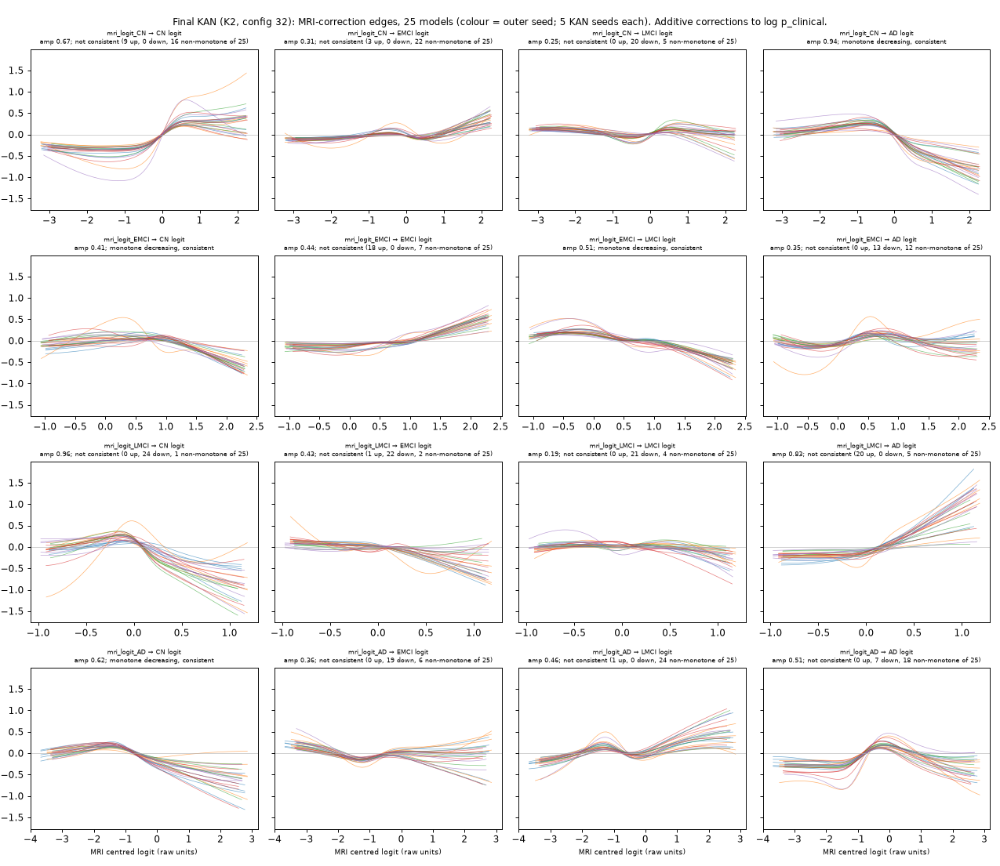

# fusion-v3 — stream specialists + KAN fusion

Branch `fusion-v3` (from `kan-fusion`). Date 2026-10-01.

**Process:**
- Tuning used train cross-validation only. Val was a sanity check.
- 35 of the 40 allowed configurations were logged (`config_log.csv`).
- The freeze (`freeze.md`, commit `8f351b6`) was committed and pushed before
  any test subject's scan or features was read.
- Test was then run once (`adc4ccb`), with no re-runs and no failures.

## Summary

| Component | Helps? | Evidence |
|---|---|---|
| **Clinical specialist** | **Yes. It carries the staging.** | CV macro-F1 0.744; test 0.771 |
| **MRI specialist, standalone** | **Yes, as an AD detector. Weak at staging.** | AD-vs-rest AUC 0.880 CV / 0.873 test. 4-class macro-F1 0.42 / 0.44, against 0.14 for the majority class. LMCI F1 ≈ 0.1 |
| **MRI inside the fusion** | **No reliable gain.** | Fusion vs the same fusion with MRI masked: +0.007 CV, CI [−0.006, +0.019] |
| **KAN fusion vs clinical specialist** | **No reliable gain.** | CV +0.013 [−0.006, +0.034]; test −0.008 [−0.081, +0.065] |
| **KAN fusion vs CatBoost F** (previous final) | **Equal.** | CV −0.002 [−0.021, +0.018]; test +0.018 [−0.045, +0.083] |
| **What the KAN changes** | **It trades EMCI for LMCI.** | The class-balanced loss raises LMCI F1 (CV 0.41 → 0.50; test 0.40 → 0.47) and costs EMCI F1 |
| **Severity index** | **Yes.** | Monotonic CN < EMCI < LMCI < AD in CV, val and test for every system; ρ with stage 0.88 on test |

**The KAN fusion is the final decision layer, as the design requires.** It is
as accurate as the CatBoost alternatives within the CIs, not better. MRI
contributes as a standalone AD-evidence stream and through the MRI-correction
edges. It adds no measurable staging accuracy, consistent with every earlier
experiment (blueprint §2).

## 1. Architecture as built

**Clinical specialist:**
- CatBoost, harness settings, fixed 265 trees.
- Inputs: the top 12 of the 29 arm-A0 clinical features. K = 12 was chosen on
  train CV in kan-fusion. The features are ranked by SHAP inside every fit.
- It reproduces kan-fusion's CatBoost C out-of-fold predictions exactly (max
  difference 0).

**MRI specialist:**
- Inputs:
  - the 6 FreeSurfer volume/ICV ratios;
  - cross-fitted ALZ;
  - the corrected brain-age gap. α and β are refitted on the training rows' CN
    subjects inside every fit. The gap is NaN when the reliability rule fails.
  - age and sex.
- Six candidates were compared by train CV:

| Config | Candidate | CV log-loss | CV macro-F1 | AD AUC |
|---|---|---|---|---|
| 1 | CatBoost, depth 2, 150 trees | 1.133 | 0.362 | 0.872 |
| 2 | CatBoost, depth 3, 300 trees | 1.128 | 0.391 | 0.875 |
| **3** | **multinomial logistic, C 0.1 (selected)** | **1.105** | **0.424** | **0.880** |
| 4 | multinomial logistic, C 1 | 1.113 | 0.422 | 0.878 |
| 5 | ordinal logistic (Frank–Hall), C 0.1 | 1.129 | 0.412 | 0.881 |
| 6 | MLP, 16 hidden units | 1.259 | 0.355 | 0.793 |

- Selection was by log-loss, because the specialist's job is to feed calibrated
  probabilities to the stacker. The logistic model also has the best macro-F1.
- For reference, the class prior has a log-loss of 1.341.

**Stacking:**
- For each outer fold (5-fold × seeds 42–46, the harness folds), inner
  5-fold out-of-fold stream scores are built within the outer-train set. The
  KAN trains on these.
- Specialists fitted on the whole outer-train set score the outer-test fold
  (`streams.npz`).

**KAN fusion:**
- Inputs: clinical centred log-probabilities (4), MRI centred log-probabilities
  (4), the has_mri flag, and optional extras.
- Modality dropout: in each step, 15% of rows get neutral MRI inputs and flag 0.
- Outputs: COG (4 classes), ADD (AD vs rest, a separate output), and severity
  s = Σ k·p(k).
- Every KAN prediction averages 5 KAN seeds.

## 2. Configuration log (all 35 configurations)

**Adoption rule** (set before iterating): a change is kept for a variant if
CV macro-F1 rises by ≥ 0.003. The final config is the one with the highest CV
macro-F1 overall.

| # | System | Change tested | CV macro-F1 | CV LMCI F1 | Decision |
|---|---|---|---|---|---|
| 1–6 | MRI specialist | candidates (table above) | 0.355–0.424 | 0.07–0.19 | #3 selected |
| 7 | Clinical specialist | top-12 CatBoost | 0.7435 | 0.407 | used |
| 8–11 | K1 [9 → 4] | G {3, 5} × μ {1e-3, 1e-2} | 0.7399 / 0.7401 / 0.7423 / **0.7437** | 0.39–0.41 | #11 best K1 |
| 12–15 | K2 residual | same grid | 0.7376 / 0.7316 / **0.7427** / 0.7367 | 0.36–0.42 | #14 best K2 |
| 16–19 | K3 [9 → 4 → 4] | same grid | 0.7393 / 0.7397 / **0.7418** / 0.7389 | 0.38–0.40 | #18 best K3 |
| 20 | K1 | input scale/range fix **off** | 0.7436 | 0.408 | fix kept: log-loss 0.564 vs 0.546 and seed SD doubles without it |
| 21 | K2 | temperature-calibrated logits | 0.7424 | 0.422 | not adopted (no-op for z-scored K1/K3 inputs, so not run there) |
| 22 | K1 | + age, CDRSB, CogIndex, MMSE | **0.7512** | 0.425 | adopted (+0.0075) |
| 23 | K2 | + age, top-3 | 0.7460 | 0.419 | adopted (+0.0033) |
| 24 | K3 | + age, top-3 | 0.7446 | 0.408 | not adopted (+0.0028) |
| 25 | K1 | label smoothing 0.1 | 0.7475 | 0.410 | not adopted |
| 26 | K1 | class-balanced CE | **0.7559** | 0.496 | adopted; K1 final |
| 27 | K2 | label smoothing 0.1 | 0.7486 | 0.421 | not adopted (+0.0026) |
| 28 | K2 | class-balanced CE | 0.7555 | 0.507 | adopted (+0.0095) |
| 29 | K3 | label smoothing 0.1 | 0.7398 | 0.388 | not adopted |
| 30 | K3 | class-balanced CE | 0.7465 | 0.468 | adopted |
| 31 | K1 | + ordinal (0.5 × squared EMD) | 0.7559 | 0.488 | no change (+0.0000) |
| **32** | **K2** | **+ ordinal** | **0.7562** | 0.495 | **highest CV macro-F1 → final** |
| 33 | K3 | + ordinal | 0.7475 | 0.463 | K3 final |
| 34 | K2 #32, MRI masked | control | 0.7495 | 0.472 | measures the MRI share |
| 35 | K1 #26, MRI masked | control | 0.7474 | 0.469 | measures the MRI share |

- **Gains flattened** after iteration 4 (class-balanced loss). The ordinal loss
  moved nothing, so iteration stopped with 5 configurations unused.
- **There were no KAN training failures** in any configuration (0 of 150 fits
  each).
- **Final selection is a near-tie:** #32 beats #26 by 0.0003. The two are
  indistinguishable.

## 3. Results: train CV (primary), val (sanity), test (single frozen run)

**CV:** 569 subjects, mean ± SD over 5 seeds. **Val:** 122 subjects, specialists
fitted on 569. **Test:** 123 subjects, everything refitted on 691, each system
seed-averaged. The MRI specialist is scored on subjects with a scan (567 /
121 / 123).

| System | CV macro-F1 | Val macro-F1 | **Test macro-F1** | CV acc | Test acc | CV bal. acc | Test bal. acc | CV LMCI F1 | Test LMCI F1 | CV AD F1 | Test AD F1 | CV AD AUC | Test AD AUC |
|---|---|---|---|---|---|---|---|---|---|---|---|---|---|
| CatBoost R (36 incl. FreeSurfer, reference) | 0.752 ± 0.006 | 0.778 | **0.784** | 0.774 | 0.813 | 0.750 | 0.791 | 0.410 | 0.432 | 0.865 | 0.898 | 0.982 | 0.993 |
| CatBoost F (previous final) | 0.758 ± 0.014 | 0.775 | **0.746** | 0.774 | 0.772 | 0.753 | 0.759 | 0.439 | 0.341 | 0.865 | 0.880 | 0.983 | 0.997 |
| Clinical specialist | 0.744 ± 0.011 | 0.763 | **0.771** | 0.763 | 0.797 | 0.740 | 0.780 | 0.407 | 0.400 | 0.846 | 0.898 | 0.983 | 0.995 |
| MRI specialist (scan subjects) | 0.424 ± 0.005 | 0.391 | **0.438** | 0.489 | 0.504 | 0.441 | 0.472 | 0.142 | 0.071 | 0.561 | 0.586 | 0.880 | 0.873 |
| KAN K1 (#26) | 0.756 ± 0.011 | 0.781 | — | 0.754 | — | 0.757 | — | 0.496 | — | 0.863 | — | 0.986 | — |
| **KAN K2 (#32, final)** | **0.756 ± 0.014** | 0.760 | **0.764** | 0.756 | 0.764 | 0.756 | 0.773 | 0.495 | 0.471 | 0.866 | 0.857 | 0.984 | 0.992 |
| KAN K3 (#33) | 0.748 ± 0.005 | 0.771 | — | 0.750 | — | 0.746 | — | 0.463 | — | 0.845 | — | 0.980 | — |
| KAN K2, MRI masked (control) | 0.749 ± 0.011 | 0.750 | — | 0.752 | — | 0.749 | — | 0.472 | — | 0.855 | — | 0.984 | — |

**KAN ADD-head AUC (final):** 0.984 CV, 0.994 val, 0.992 test. Only the frozen
final variant was run on test; K1 and K3 were not.

**Paired bootstrap of macro-F1 differences** (2,000 resamples; CV and val are
means over seeds; test is the single frozen system):

| Comparison | CV | Val | Test |
|---|---|---|---|
| K1 − clinical specialist | +0.012 [−0.007, +0.032] | +0.019 [−0.033, +0.067] | — |
| K1 − CatBoost F | −0.002 [−0.021, +0.017] | +0.006 [−0.063, +0.069] | — |
| **K2 (final) − clinical specialist** | **+0.013 [−0.006, +0.034]** | −0.003 [−0.051, +0.045] | **−0.008 [−0.081, +0.065]** |
| **K2 (final) − CatBoost F** | **−0.002 [−0.021, +0.018]** | −0.015 [−0.087, +0.052] | **+0.018 [−0.045, +0.083]** |
| K2 (final) − CatBoost R | +0.004 [−0.018, +0.025] | −0.018 [−0.085, +0.049] | −0.020 [−0.076, +0.040] |
| K3 − clinical specialist | +0.004 [−0.014, +0.022] | +0.008 [−0.042, +0.061] | — |
| K3 − CatBoost F | −0.010 [−0.029, +0.008] | −0.005 [−0.065, +0.057] | — |
| K2 final − K2 MRI masked (MRI share) | +0.007 [−0.006, +0.019] | +0.010 [−0.037, +0.055] | — |
| K2 MRI masked − clinical (loss/extras share) | +0.006 [−0.011, +0.024] | −0.012 [−0.052, +0.025] | — |

**Every CI includes zero.** The test CIs are about ±0.07 wide, which is what 123
subjects with 24 LMCI allow.

**Confusion matrices on test** (rows are true CN / EMCI / LMCI / AD):

| Clinical specialist | KAN fusion (final) | CatBoost F | CatBoost R |
|---|---|---|---|
| 29 0 0 0 / 0 39 7 1 / 0 13 8 3 / 0 0 1 22 | 29 0 0 0 / 0 32 13 2 / 0 9 12 3 / 0 0 2 21 | 29 0 0 0 / 0 37 9 1 / 0 13 7 4 / 0 0 1 22 | 29 0 0 0 / 0 41 5 1 / 0 13 8 3 / 0 1 0 22 |

CV and val confusion matrices are in `eval_tables.md`; the test outputs are in
`frozen_run/test_results.md`.

## 4. The three MRI roles

**(a) MRI specialist standalone vs the majority-class baseline (EMCI)**

| | CV (567) | Val (121) | Test (123) | Majority class (test) |
|---|---|---|---|---|
| 4-class macro-F1 | 0.424 | 0.391 | 0.438 | 0.138 |
| 4-class accuracy | 0.489 | 0.446 | 0.504 | 0.382 |
| Balanced accuracy | 0.441 | 0.420 | 0.472 | 0.250 |
| 3-class macro-F1 (CN / MCI / AD) | 0.499 | 0.448 | 0.554 | 0.244 |
| 3-class accuracy | 0.612 | 0.545 | 0.634 | 0.577 |
| **AD vs rest AUC** | **0.880** | **0.811** | **0.873** | 0.500 |
| F1 by class, CN / EMCI / LMCI / AD | 0.39 / 0.60 / 0.14 / 0.56 | 0.44 / 0.49 / 0.07 / 0.56 | 0.54 / 0.55 / 0.07 / 0.59 | 0 / 0.55 / 0 / 0 |

**MRI separates AD from the rest well** (AUC 0.87–0.88), better than ALZ alone
(0.76). It is near chance on LMCI, and its 3-class accuracy is barely above the
majority class.

**(b) MRI-only mode (MRI + age + sex, no cognitive tests) vs clinical only,
same subjects**

| | CV: MRI-only | CV: clinical | Test: MRI-only | Test: clinical |
|---|---|---|---|---|
| AD vs rest AUC | 0.880 | 0.983 | 0.873 | 0.995 |
| 4-class accuracy | 0.489 | 0.763 | 0.504 | 0.797 |
| 3-class accuracy | 0.612 | 0.919 | 0.634 | 0.976 |

**Without cognitive tests the system still flags AD reliably,** at about 0.87
AUC. It cannot stage MCI.

**(c) Fusion vs clinical specialist**

| | CV (mean over seeds) | Test |
|---|---|---|
| Macro-F1 difference | +0.013 [−0.006, +0.034] | −0.008 [−0.081, +0.065] |
| Of which MRI (vs the MRI-masked control) | +0.007 [−0.006, +0.019] | — |
| LMCI → AD errors | 17.2 → 14.6 | 3 → 3 |
| AD → LMCI errors | 11.0 → 10.2 | 1 → 2 |
| LMCI → EMCI errors | 57.0 → 41.2 | 13 → 9 |
| EMCI → LMCI errors | 30.8 → 49.0 | 7 → 13 |

**What the fusion changes:**
- Its main effect is on the EMCI/LMCI boundary, and it comes from the
  class-balanced loss.
- It recovers LMCI subjects (CV LMCI correct 39.8 → 57.0; test 8 → 12) and
  mislabels more EMCI as LMCI.
- On CV the LMCI/AD boundary errors fall slightly; on test they don't move.
- The MRI share of the gain is +0.007 and not reliable.

## 5. KAN interpretability (final K2)

**Setup:** 25 models (outer seeds × KAN seeds) trained on the 569 train
out-of-fold scores (`kan_interpret.py`, `kan_interp.md`).

**How to read the edges:** K2 is a single-layer KAN added to the clinical
log-probabilities, so each edge is an additive correction to one output logit.

**A caution:** the 4 centred MRI logits sum to zero, so their edges are not
separately identifiable. They should be read together.

**MRI-correction edges: monotone and consistent across all 25 models**
- MRI CN-logit → AD output: decreasing. Imaging that looks normal lowers AD
  (median amplitude 0.94 logit).
- MRI AD-logit → CN output: decreasing. Imaging that looks like AD lowers CN
  (0.62).
- MRI EMCI-logit → CN output and → LMCI output: both decreasing (0.41, 0.51).

**Near-consistent (20–24 of 25 models in the same direction)**
- MRI LMCI-logit → AD: increasing, in 20 of 25 (0.83).
- MRI LMCI-logit → CN: decreasing, in 24 of 25 (0.96).
- MRI CN-logit → LMCI: decreasing, in 20 of 25.

**Not monotone**
- The direct MRI AD-logit → AD edge is non-monotone in 18 of 25 models.
- So is MRI AD-logit → LMCI.
- The AD signal reaches the output mainly by suppressing CN and through the LMCI
  logit, not through a direct AD edge.

**Shapes are stable across seeds:** every one of the 25 curves for an edge has a
similar shape.

**has_mri flag:** effect ≈ 0 (median jump |φ(1) − φ(0)| ≤ 0.007 logit).
- Only 3 training subjects lack a scan.
- Missing-MRI handling comes from the neutral inputs and modality dropout, not
  from the flag.

**Pruning** (`prune_input`, threshold 0.01):
- has_mri is removed in all 25 models (attribution 0.001).
- Every other input survives in all 25.
- **Attribution shares:** clinical logits 38%, MRI logits 26%, CDRSB 11%, MMSE
  9%, CogIndex 8%, age 8%.

**Clinical and extra inputs:**
- Consistent edges: CogIndex → LMCI and → AD (decreasing), MMSE → AD
  (decreasing), age → LMCI (decreasing), clinical CN-logit → LMCI (decreasing).
- See `kan_edges_all.png` and `kan_interp.md`.

## 6. Severity index (s = Σ k·p(k))

| System | Val: mean s CN / EMCI / LMCI / AD | Test: mean s | Monotonic (CV / val / test) | ρ(s, stage), test | ρ(s, CDRSB), test |
|---|---|---|---|---|---|
| KAN K2 (final) | 0.05 / 1.26 / 1.64 / 2.84 | 0.00 / 1.40 / 1.77 / 2.87 | yes / yes / yes (CV and val in 5/5 seeds) | 0.884 | 0.901 |
| Clinical specialist | 0.08 / 1.18 / 1.53 / 2.84 | 0.04 / 1.27 / 1.66 / 2.85 | yes / yes / yes | 0.888 | 0.905 |
| CatBoost F | 0.09 / 1.19 / 1.53 / 2.80 | 0.05 / 1.28 / 1.64 / 2.86 | yes / yes / yes | 0.883 | 0.901 |

- **The fusion does not widen the EMCI–LMCI severity gap:** 0.37 on test vs
  0.39 for clinical, and 0.42 vs 0.41 on CV.
- **ρ with CDRSB is not independent validation:** CDRSB is an input and helps
  define the labels.

## 7. Limitations

- **Selection optimism:** configurations were selected on the same CV that
  reports them, using 35 configurations. The final pick (#32) beat #26 by
  0.0003, which is noise. CV numbers for the KAN rows are therefore slightly
  optimistic. The test run is the unbiased check.
- **Test is small:** 123 subjects, 24 LMCI. Test differences of ±0.07 macro-F1
  are inside the CIs.
- **The clinical specialist is not the original step-5 model.** The original's
  test result was 0.813 accuracy and 0.786 macro-F1. CatBoost R refitted on 691
  reproduces it closely: 0.813 and 0.784.
- **ALZ CNNs were not retrained** on train+val. Test ALZ is the mean of the 15
  cross-fit models, as val ALZ was.
- **No test scan failed the brain-age reliability rule,** and no test scan was
  excluded for registration.
- **Freeze rule written before test access:** the brain-age registration
  exclusion (corr_vs_mni < 0.15) reproduces the original train/val exclusion
  exactly.
- **Final training set size:** the task text gives 689 subjects; the clinical
  split has 691 (569 + 122), and all 691 were used.

## 8. Files

| File | Content |
|---|---|
| `config_log.csv` | all 35 configurations: inputs, hyperparameters, CV metrics, decisions |
| `specialists.py`, `step1_mri_select.py`, `step2_streams.py`, `streams.npz` | specialists; nested stream scores |
| `kan_fusion.py`, `cfg_*.json`, `kan_*.log`, `kan_runs/<id>.npz` | KAN fusion runs |
| `evaluate.py`, `eval_tables.md`, `eval_summary.json`, `eval_runs.csv` | CV and val evaluation |
| `kan_interpret.py`, `kan_edges_mri.png`, `kan_edges_all.png`, `kan_interp.md` | edge functions, pruning |
| `freeze.md`, `frozen/` (models, stats, `MANIFEST.sha256`), `freeze_fit_*.py`, `final_features.py` | the freeze |
| `scan_inputs.py`, `brainage_split.py`, `test_*.py`, `freeze_guard.py`, `frozen_run/` | test-time pipeline and outputs (val dry run + test) |
