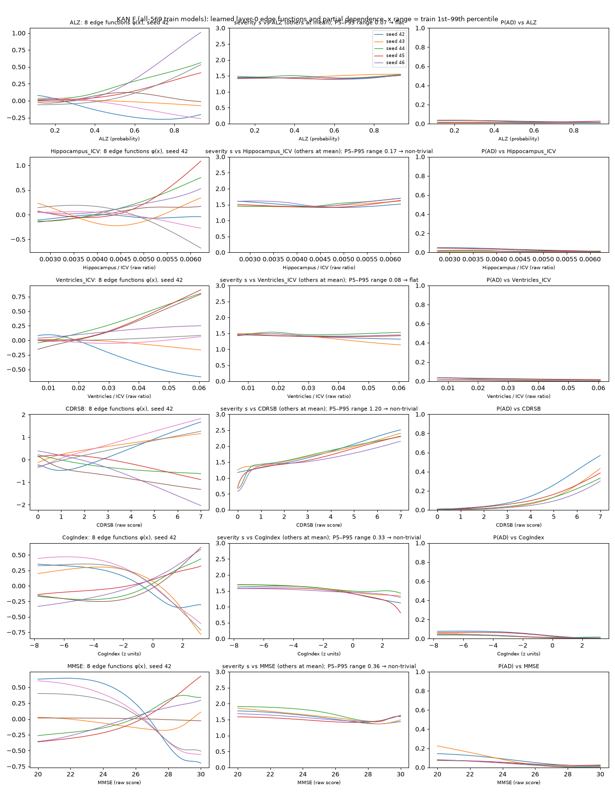

# KAN fusion — results (train/val only)

Branch `kan-fusion`. Date 2026-10-01.
Rules: `preregistration.md` (commit `8da778c`) and its KAN addendum (`c8788a7`),
both committed before any model was fitted on the fusion dataset.
The test set was not read; it is evaluated once, in Prompt 3.

## Verdict

**CatBoost on F is the final decision layer.** KAN is reported as the
interpretability comparison.
- **KAN trains stably.** 0 of 60 refits failed (50 CV, 10 val) and 0 of 1,440
  inner fits failed.
- **KAN is clearly less accurate.** On F it is 0.058 macro-F1 below CatBoost on
  CV, CI [−0.078, −0.038]. That is far outside the −0.02 non-inferiority margin.
- **Imaging gives no reliable staging gain for CatBoost:** F − C is +0.014 on
  CV, CI [−0.001, +0.029], with val +0.011. The point estimate is positive and
  the CI only just includes zero, so by the rule this is "no reliable
  difference".
- **For KAN, adding the MRI inputs reliably hurts:** −0.023 on CV, −0.055 on val.

## 1. Results

Macro-F1 is the primary metric. Values are mean ± SD over seeds 42–46.
- **CV:** stratified 5-fold over the 569 clinical-train subjects, pooled
  out-of-fold predictions per seed.
- **Val:** trained on 569, scored on 122 clinical-val.
- **Differences:** paired bootstrap (2,000 resamples of subjects, mean over seeds).
- Val CIs are descriptive only.

| Row | CV macro-F1 | Val macro-F1 | CV LMCI F1 | CV AD F1 | Val LMCI F1 | Val AD F1 | CV AD AUC |
|---|---|---|---|---|---|---|---|
| CatBoost C (clinical top-12) | 0.744 ± 0.011 | 0.764 ± 0.020 | 0.407 | 0.846 | 0.353 | 0.909 | 0.983 |
| **CatBoost F (C + 7 MRI) — final** | **0.758 ± 0.014** | **0.775 ± 0.017** | 0.439 | 0.865 | 0.376 | 0.942 | 0.983 |
| KAN C | 0.723 ± 0.017 | 0.777 ± 0.024 | 0.405 | 0.847 | 0.453 | 0.915 | 0.981 |
| KAN F | 0.700 ± 0.017 | 0.722 ± 0.029 | 0.397 | 0.830 | 0.359 | 0.919 | 0.980 |
| CatBoost R (36 features incl. FreeSurfer, reference) | 0.752 ± 0.006 | 0.778 ± 0.020 | 0.410 | 0.865 | 0.395 | 0.917 | 0.982 |
| **MRI contribution (F − C), CatBoost** | **+0.014 [−0.001, +0.029]** | +0.011 [−0.045, +0.068] | | | | | |
| **MRI contribution (F − C), KAN** | **−0.023 [−0.041, −0.006]** | −0.055 [−0.100, −0.014] | | | | | |
| KAN − CatBoost on F (non-inferiority, margin −0.02) | −0.058 [−0.078, −0.038] | −0.053 [−0.110, +0.002] | | | | | |
| KAN − CatBoost on C (descriptive) | −0.020 [−0.039, −0.002] | +0.013 [−0.032, +0.057] | | | | | |
| CatBoost C − R (descriptive) | −0.008 [−0.023, +0.007] | −0.014 | | | | | |
| CatBoost F − R (descriptive) | +0.006 [−0.008, +0.021] | −0.003 | | | | | |

**Rule outcomes:**

| Rule | Outcome |
|---|---|
| e1, CatBoost | **No reliable difference.** The CI includes 0. The val difference has the same sign, but the CI condition fails. |
| e1, KAN | **Reliable loss.** The CI is entirely below 0, and val is also negative. |
| e2 | **KAN is not non-inferior.** The CI lower bound is −0.078, below −0.02. CatBoost is the final decision layer. |

**Other observations:**
- **ALZ alone:** AD-vs-rest AUC 0.764 on CV (cross-fitted) and 0.778 on val.
- **Harness check:** CatBoost R reproduces arm A of the earlier ablations exactly
  (CV 0.752, val 0.778).
- **Restricting to subjects with a scan** (567 CV / 121 val) moves every
  difference by ≤ 0.006.
- **Where CatBoost F's small, unreliable CV gain comes from:**
  - LMCI F1 rises from 0.407 to 0.439.
  - AD F1 rises from 0.846 to 0.865.
  - LMCI→AD errors fall from 17.2 to 14.8 (mean over seeds), and AD→LMCI errors
    from 11.0 to 8.8.
  - This is the LMCI/AD boundary, where anatomy was expected to help.
  - LMCI→EMCI errors, the main error mass, stay at 56–57.
- **KAN's loss is concentrated in CN and EMCI.** CV CN F1 is 0.854 for KAN F vs
  0.946 for CatBoost F. On val, KAN F calls 3.2 of 28 CN subjects EMCI and 2.8
  of 46 EMCI subjects CN, against 1.0 and 0.0 for CatBoost. With 19 inputs on
  about 390 fitting rows per fold, the KAN overfits the extra inputs. 4 of the 5
  val models for F were tuned to μ = 0, i.e. no sparsity penalty.
- **The only good KAN number is on val.** KAN C reaches 0.777 on val with the
  best LMCI F1 of any row (0.453). But it is 0.020 below CatBoost C on CV, and
  val has only 25 LMCI subjects.

Full tables (accuracy, balanced accuracy, per-class F1, stage-distance error,
the ADD head's AUC, confusion matrices, the scan-only subset) are in
`eval_tables.md`, with per-seed rows in `eval_runs.csv`.

### Clinical top-K (item b)

| K | CV macro-F1 of CatBoost C |
|---|---|
| 8 | 0.7424 |
| 10 | 0.7433 |
| **12** | **0.7435** |

**K\* = 12.** The three values are effectively tied.

**Frozen list (for val and test):** CDRSB, CogIndex, MMSE, ADAS13, ADAS11,
EcogSPMem, RAVLT_perc_forgetting, FAQ, EcogSPPlan, EcogSPDivatt, RAVLT_learning,
PTEDUCAT.

**Stability across the 25 fold-seeds:**
- 7 features are in every fold-level top-12.
- FAQ is in 21 of 25.
- The last four slots rotate among EcogSPDivatt, EcogSPPlan, RAVLT_learning,
  PTEDUCAT, MOCA, EcogSPTotal and EcogSPOrgan.

### KAN training (addendum K2–K3)

**Stability:**
- All 60 jobs completed in 132 s on 14 CPU workers.
- 0 failures under the pre-registered definition, among both outer refits and
  inner fits.
- Early stopping chose steps 35–83 of the 400 allowed.

**Configuration choice is unstable.**
- Each of the 8 (grid, λ, μ) configs won between 4 and 11 of the 60 jobs.
- The inner CV macro-F1 of the 8 configs spans a median of 0.03 per job
  (range 0.01–0.07).
- Val models for F chose (G, λ, μ):

  | Seed | G | λ | μ |
  |---|---|---|---|
  | 42 | 3 | 1.0 | 0 |
  | 43 | 3 | 1.0 | 1e-3 |
  | 44 | 5 | 0.5 | 0 |
  | 45 | 3 | 1.0 | 0 |
  | 46 | 5 | 1.0 | 0 |

- All choices are in `kan_runs.json`.

## 2. Interpretability (KAN F, the 5 all-569 models)

Figures:
- `kan_edges.png`: the 8 layer-0 edge functions (seed 42), plus partial
  dependence of severity and P(AD) with all 5 seeds overlaid, for ALZ,
  Hippocampus/ICV, Ventricles/ICV, CDRSB, CogIndex and MMSE.
- `kan_attribution.png`: input attribution.

The full per-input table is in `kan_interp.md`.



### Are the ALZ and volume curves flat?

The pre-registered rule: flat if the median severity range over the input's
train P5–P95 is < 0.10 stage units.

| Input | Severity range, median [min, max] | Rule verdict | Seeds sloping the expected way (sign of Spearman ρ of the curve) |
|---|---|---|---|
| ALZ | 0.07 [0.06, 0.13] | **flat** | 3/5 (the right end is higher than the left in all 5, by 0.05–0.13) |
| Ventricles / ICV | 0.08 [0.06, 0.25] | **flat** | **1/5** (larger ventricles → *lower* severity in 4) |
| Hippocampus / ICV | 0.17 [0.13, 0.22] | non-trivial | **1/5** (larger hippocampus → *higher* severity in 4) |
| WholeBrain / ICV | 0.10 [0.07, 0.17] | flat (at threshold) | 2/5 |
| Entorhinal / ICV | 0.17 [0.08, 0.26] | non-trivial | 5/5 |
| Fusiform / ICV | 0.36 [0.22, 0.43] | non-trivial | 5/5 |
| MidTemp / ICV | 0.14 [0.05, 0.16] | non-trivial | 4/5 |
| CDRSB (reference) | 1.20 [0.73, 1.34] | non-trivial | 5/5 |

**ALZ and ventricles are flat.** The individual layer-0 edges are not flat:
several ALZ and ventricle edges are clearly curved, ranging up to ±1. They cancel
through the hidden layer, so the network output barely moves.

**Hippocampus passes the "non-trivial" threshold, but its curve is not a usable
explanation.** It is shallow and U-shaped, and slopes the wrong way in 4 of 5
seeds. The ventricle curve also slopes the wrong way in 4 of 5.

**The only volume curves that are both non-trivial and consistent are
fusiform/ICV and entorhinal/ICV.** Both are monotone decreasing in every seed.
Fusiform was also the top FreeSurfer feature by SHAP in the step-0 gate.

**P(AD) is near zero on every partial-dependence plot.** The plots hold the other
inputs at the training mean, which is an EMCI-like subject. One-at-a-time
partial dependence at that point cannot show AD-range effects. Treat these plots
as the input's marginal pull, not as a patient-level explanation.

**Clinical curves are smooth and monotone in the expected direction:**
- CDRSB: severity rises 1.2–1.6 stage units over its range, with a step between
  0 and 0.5.
- MMSE and CogIndex: severity falls.

### Pruning

**`prune_input(threshold=1e-2)` keeps all 19 inputs in all 5 seeds.**
- The smallest attribution score of any input in any seed is 0.085, more than 8×
  the threshold.
- So pruned val macro-F1 equals the unpruned model's (0.672–0.744).

**Attribution ranking:**
- The first four places, in order: CDRSB (14.7% of total attribution), MMSE,
  CogIndex, FAQ.
- The best-ranked MRI input is Fusiform/ICV (7th, 5.2%).
- ALZ is 18th of 19 (3.0%).
- The seven MRI inputs together take 25% of the attribution, yet add nothing to
  KAN accuracy.

**Without a sparsity penalty, the KAN spreads weight across every input rather
than selecting.** PTEDUCAT, for example, moves severity by 0.36.

## 3. Severity index (item f)

s = Σ k · p(stage k), computed from seed-averaged probabilities.

| Model | Mean s on val: CN / EMCI / LMCI / AD | Monotonic (seed-avg; per seed) | ρ(s, stage) val / CV | ρ(s, CDRSB) val / CV |
|---|---|---|---|---|
| **CatBoost F (final)** | 0.09 / 1.19 / 1.53 / 2.80 | **yes; 5/5** | **0.868 / 0.871** | 0.857 / 0.889 |
| CatBoost C | 0.09 / 1.17 / 1.54 / 2.85 | yes; 5/5 | 0.875 / 0.870 | 0.881 / 0.892 |
| KAN F | 0.16 / 1.16 / 1.51 / 2.85 | yes; 5/5 | 0.859 / 0.867 | 0.874 / 0.900 |

**The monotonicity check passes** for every model, on val and CV, in every seed.

**EMCI and LMCI are close** (gap about 0.35, against about 1.1 for CN to EMCI and
about 1.3 for LMCI to AD). This mirrors the classifier's main error, LMCI→EMCI.

**ρ(s, CDRSB) is not independent validation.** CDRSB is a model input (the
top-ranked one) and is part of how the labels are defined.

## 4. Discordance flag (item g)

**Definition:** CatBoost C prediction, with thresholds from train AD ALZ:
P10 = 0.2981, P90 = 0.8751.

| | Val | Train (CV out-of-fold) |
|---|---|---|
| Evaluable | 121 (1 without ALZ) | 567 (2 without ALZ) |
| Flagged | **1** | **13** (2.3%) |
| Branch 1 (pred AD, low ALZ) | 1 | 9 |
| Branch 2 (pred CN/EMCI, high ALZ) | 0 | 4 |
| Flagged by true class | AD 1/23 | AD 9/104, LMCI 3/114, EMCI 1/216, CN 0/133 |
| CatBoost C error rate: flagged vs unflagged | 0/1 vs 25/120 | 3/13 (23%) vs 130/554 (23%) |
| Final layer (CatBoost F) error rate: flagged vs unflagged | 0/1 vs 22/120 | 2/13 (15%) vs 123/554 (22%) |

**What the flag catches:**
- The one val flag is 135_S_4954: a true AD subject predicted AD by both models,
  with ALZ 0.24.
- On train, flagged subjects are no more often misclassified than unflagged ones.

**What the flag means:** clinical and imaging evidence disagree. It does not mean
the clinical call is wrong. This is descriptive only, as pre-registered. Branch 2
fires rarely, as the pre-registration predicted.

## 5. Brain-age reliability (item h)

Unchanged from the pre-registration:
- 3 of 567 train scans are flagged unreliable, all GE IR-SPGR and about 23%
  saturated.
- 0 of 121 val scans are flagged.

## 6. Notes and limitations

- **Interpreting the e1 result for CatBoost:** imaging does not reliably add
  staging accuracy. This is the sixth consistent null in the evidence log. The
  point estimate (+0.014), though, is the largest any imaging addition has
  produced, and it sits on the LMCI/AD boundary.
- **Test plan:** the frozen test evaluation (Prompt 3) will show C, F and R side
  by side, with no rule depending on it.
- **K\* is chosen on the same CV** that scores C and F. K = 8, 10 and 12 are
  within 0.001, so the optimism is negligible.
- **KAN capacity:** the KAN's poorer CV accuracy is a property of this
  configuration on about 455 training rows. A sparser or smaller KAN might do
  better, but trying more configurations now would be tuning after seeing
  results. That belongs in a new pre-registration, not this report.
- **Val is mildly optimistic for CatBoost:** the 265 trees were originally chosen
  on val in step 5.
- **Val is small:** 25 LMCI and 23 AD subjects. Val differences within ±0.05 are
  inside the descriptive CIs.

## 7. Files

| File | Content |
|---|---|
| `catboost_stage.py`, `catboost_stage.log`, `catboost_preds.npz`, `topk.json` | top-K selection; CatBoost C/F/R predictions |
| `kan_stage.py`, `kan_stage.log`, `kan_preds.npz`, `kan_runs.json`, `kan_interp.json` | nested KAN fits, predictions, chosen configs, diagnostics, interpretability data |
| `evaluate.py`, `eval_tables.md`, `eval_runs.csv`, `eval_summary.json`, `discordance_val.csv` | metrics, bootstraps, verdicts, severity, discordance |
| `kan_plots.py`, `kan_edges.png`, `kan_attribution.png`, `kan_interp.md`, `kan_interp_summary.csv` | edge functions, partial dependence, attribution, pruning |

**Reproduce:**

```
.venv-fusion/bin/python analysis/kan_fusion/catboost_stage.py   # ~1 min
.venv-kan/bin/python    analysis/kan_fusion/kan_stage.py        # ~2 min, 14 workers
.venv-fusion/bin/python analysis/kan_fusion/evaluate.py
.venv-kan/bin/python    analysis/kan_fusion/kan_plots.py
```

**`LYP/.venv-kan` pins:** Python 3.12.3, pykan 0.2.8, torch 2.14.1+cpu,
numpy 2.5.3, pandas 3.0.6, scikit-learn 1.9.1, scipy 1.18.1, matplotlib 3.11.2,
sympy 1.14.0.
